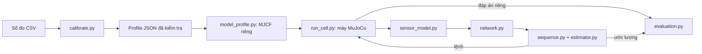

# Lõi Digital Twin dạng mô-đun và tiếp nhận số đo

**Cập nhật:** [observer và sức khỏe tín hiệu](observer_health.md),
[tái cấu hình tốc độ/HOLD](reconfiguration.md), [chỉ mục tiến độ và tác dụng từng phần](dt_core_progress.md).

**Cập nhật 30/10/2026:** [plant tham số hóa, ba quang và bảng nhập đầy đủ](parameterized_core.md).
Importer CSV hiện hỗ trợ mọi trường số được khai báo đơn vị trong profile hiện tại,
bao gồm cơ học mới; không chỉ tập `calibrate.UNITS` hạn chế của phiên bản đầu.

Phiên bản cấu hình 1, ngày 27/10/2026. Hiện là lõi mô phỏng; chưa kết nối PLC thật.

**Bổ sung mới:** [dự báo nhiều kịch bản 1D và supervisor theo ngân sách](predictive_core.md).
Nhóm `prediction` có thể bật bằng profile riêng; baseline mặc định vẫn tắt.

## Mục tiêu và cấu trúc đã triển khai

Thông số của hệ thống nằm trong một profile JSON. Thuật toán nhận profile
đã kiểm tra; không cần sửa nhiều tệp Python khi đổi giá trị đã được hỗ trợ.
Không có framework mới hoặc dịch vụ mạng bên ngoài.



| Mô-đun | Trách nhiệm / ranh giới |
|---|---|
| `config.py` | Đọc JSON, kiểm tra trường/đơn vị/quy tắc chéo, tạo bản cấu hình thực dùng. |
| `model_profile.py` | Áp thông số được hỗ trợ lên bản sao MJCF, không ghi đè CAD/URDF/MJCF nguồn. |
| `run_cell.py: Cell` | Bộ nối MuJoCo; áp lệnh, giới hạn ramp, giữ, bước vật lý và trạng thái plant riêng. |
| `signals.py` | Hợp đồng tín hiệu nhị phân: giá trị, chất lượng, nguồn, số thứ tự và thời gian. |
| `sensor_model.py` | Sinh tín hiệu cảm biến lý tưởng bên trong ranh giới plant. |
| `network.py` | Giả lập trễ, jitter đều, mất mẫu và lọc thứ tự nhận bằng seed tái lập. |
| `estimator.py` | Ước lượng một phôi từ PS1/PS2; không đọc trạng thái chuẩn. |
| `sequence.py` | Máy trạng thái, điều kiện chuyển, giới hạn quan sát, timeout và watchdog. |
| `evaluation.py` | Giữ đáp án để chấm sai số và vị trí cuối; không trả đáp án về controller. |
| `experiment.py` | Ghép các mô-đun và lưu bằng chứng của một lượt. |
| `run_twin.py` | Entry point CLI ngắn, giữ tương thích cách chạy cũ. |
| `calibrate.py` | Nhập số đo có nguồn gốc, tạo profile mới, không tự chứng nhận hiệu chuẩn. |
| `command_history.py` | Tích phân lệnh đã phát theo dấu thời gian, phục vụ đổi tốc độ và xử lý gói trễ. |
| `health.py` | Tạo dấu hiệu nghi ngờ từ dữ liệu bên nhận; không đọc nhãn lỗi gây ra. |
| `reconfiguration.py` | Giới hạn tốc độ theo cảnh báo mạng hoặc yêu cầu HOLD; không tự bỏ qua lỗi/reset. |

`Cell.apply()` nhận lệnh `front`, `long`, `targets`, `vacuum`, `hold`.
`Sequence.tick()` chỉ nhận `SignalFrame` và thời gian trong cùng miền đồng
hồ. Không truyền `Cell` hay vị trí thật của phôi cho máy trạng thái.

## Một nơi để thay thông số

Profile mặc định: `mujoco/configs/simulation.json`. Giữ nó làm baseline;
tạo một profile mới cho từng đợt đo hoặc thí nghiệm.

| Nhóm | Thông số điển hình |
|---|---|
| `geometry` | Gốc XY robot, hành trình khớp, vị trí hai tia quang, kích thước/vị trí phôi, làn băng, tâm/kích thước lòng hộp. |
| `plant` | Khối lượng phôi, ma sát tiếp xúc MuJoCo, lực bám hút giả định, hệ số vận tốc băng, gain/damping và khối lượng/COM/quán tính các khâu. |
| `motion` | Tốc độ băng, tốc độ ramp từng trục/xi lanh, đích A2, khoảng cấp phôi, thời gian hút/nhả/ổn định. |
| `sensors` | Dung sai công tắc đầu-cuối, ngưỡng khoảng cách tạo tín hiệu quang. |
| `estimator` | Quãng trôi, sai số tại mốc, mức tăng bất định, giới hạn vận tốc suy ra và ngưỡng cho phép canh gắp. |
| `timing` | Bước vật lý, số bước/mẫu, ngưỡng dữ liệu cũ/khoảng khuyết/mất liên lạc, timeout chuyển động, ngân sách lượt chạy. |
| `network` | `delay_s`, `jitter_s`, `drop_probability` trong [0,1], `seed`. |
| `prediction` | Bật/tắt, khoảng dự báo, bước thời gian, ngân sách wall-clock và các trục kịch bản cho predictor 1D. |
| `profile` | Tên, trạng thái, ghi chú và lịch sử số đo/độ không chắc/phương pháp/ngày/người đo. |

Các quy tắc như tên trạng thái và thứ tự công đoạn vẫn là mã thuật toán;
không biến mọi dòng chương trình thành cấu hình. Phiên bản adapter này hỗ
trợ sáu hộp và bốn khớp như mô hình hiện tại.

### Đơn vị và ý nghĩa

- Tất cả chiều dài nhập bằng **m**, thời gian bằng **s**, tốc độ bằng **m/s**,
  khối lượng bằng **kg**, lực bằng **N**, quán tính chéo chính bằng **kg*m^2**.
- Nếu đo được 170 mm thì nhập 0.170 m; 20 g nhập 0.020 kg; 20 ms nhập 0.020 s.
  Dùng dấu chấm thập phân trong CSV/JSON.
- Lệnh tốc độ và tốc độ đo là hai thông tin khác nhau. `plant.belt_speed_scale`
  cho phép thử mô phỏng có vận tốc thực khác lệnh; estimator không đọc hệ số
  đó để biết trước vị trí phôi.
- Lực bám hút là tham số hiệu dụng của mô hình tiếp xúc, không phải áp suất.
  Không nhập số bar/kPa trực tiếp vào trường N. Mô hình chưa giải động lực
  học khí nén hoặc rò khí đã hiệu chuẩn.
- Khoảng bất định kỹ thuật trong estimator không tự biến thành khoảng tin
  cậy 95% chỉ vì đã nhập số đo. Độ không chắc của số đo trong CSV được lưu
  để truy xuất; chưa có bộ tự động nhận dạng toàn bộ mô hình từ dữ liệu.

Loader từ chối tên trường lạ/thiếu, khóa JSON trùng, NaN/Infinity, bool thay
cho số, khoảng hành trình sai, công tắc chồng cửa sổ, đích không tới được,
phôi lớn hơn lòng hộp và một số mâu thuẫn về thời gian/không gian. Kiểm tra
cấu hình không thay thế kiểm tra va chạm hoặc xác nhận vận hành trên máy.

## Khi có số đo thật: thực hiện theo thứ tự này

1. Sao chép `mujoco/configs/physical_measurements.csv` thành một tệp mới
   cho phiên đo. Mẫu hiện để trống toàn bộ giá trị, không giả tạo số đo.
2. Điền `value` và `unit` cho những mục đã đo; mục chưa đo giữ trống, không
   điền 0. Ghi `measured_on` dạng YYYY-MM-DD, `method`, người đo ở `operator`
   và điều kiện thử trong `notes`. `method` và ngày đo là bắt buộc cho dòng
   có giá trị; `uncertainty` chưa biết thì để trống, không giả định bằng 0.
3. Tên `path` là đường tới một tham số, ví dụ `geometry.ps_y_m.ps2` hoặc
   `motion.rates_m_s.a2_joint`. Chỉ các scalar có đơn vị được khai báo trong
   `calibrate.UNITS` được nhập qua CSV; không âm thầm nhận một trường lạ.
4. Dùng lệnh bên dưới để tạo profile mới. Cả lô được kiểm tra trước khi ghi;
   không ghi đè profile đã có. Dòng dùng mm thay m bị từ chối thay vì đoán đơn vị.
5. Chạy mặc định trước, rồi chỉ thử `--assume-open-loop` trong mô phỏng.
   Kiểm tra toàn bộ nghiệm thu, log và sai số trước khi chấp nhận profile.

Ví dụ lệnh PowerShell sau khi bạn đã điền tệp số đo:

```powershell
cd C:\Users\Admin\Documents\ChatGPT\plc
$py = "/home/admin/dt-cpps-venv/bin/python"
$root = "/mnt/c/Users/Admin/Documents/ChatGPT/plc"
$base = "$root/mujoco/configs/simulation.json"
$measure = "$root/mujoco/configs/measurements_session01.csv"
$profile = "$root/mujoco/configs/physical_partial_session01.json"
wsl -d Ubuntu-24.04 -- $py "$root/mujoco/calibrate.py" --base $base --measurements $measure --output $profile
wsl -d Ubuntu-24.04 -- $py "$root/mujoco/run_twin.py" --config $profile --output "$root/output/physical_profile_trial01"
```

Bạn cần tự tạo `measurements_session01.csv` từ mẫu và điền dữ liệu trước.
CSV trống không tạo được profile "đã hiệu chuẩn". Kết quả nhập có trạng thái
`partial`: một phần tham số đã nhập, các phần khác còn là giả định. Lịch sử
ghi cả hash tệp CSV và số dòng. Trạng thái này không chứng nhận số liệu do
ai đó đã kiểm tra hay máy đã được vận hành an toàn.

Khối lượng đổi có thể đòi hỏi đo/nhận dạng lại quán tính và hành vi chấp
hành; nhập một giá trị mới không bảo đảm gắp vẫn thành công. Chuyển động
A2 trung gian và phản hồi XY/chân không vẫn là giới hạn chưa được giải quyết
bằng việc sửa số. Chế độ mặc định giữ chặn trước thao tác thiếu xác nhận.

## Chạy profile có sẵn và nghiệm thu

```powershell
$cfg = "$root/mujoco/configs/slow_a2_demo.json"
wsl -d Ubuntu-24.04 -- $py "$root/mujoco/run_twin.py" --config $cfg --assume-open-loop --view --output "$root/output/slow_a2_trial01"
wsl -d Ubuntu-24.04 -- $py -u "$root/mujoco/check_twin.py" --extended --output "$root/output/modular_checks01"
```

`slow_a2_demo.json` dùng tốc độ A2 0,06 m/s, là **cấu hình tổng hợp để thử**,
không phải số đo máy thật. Các thời gian chờ hạ được tính lại theo tốc độ
mới; không cần sửa `sequence.py`. Cờ `--speed` nếu dùng sẽ ghi đè tốc độ
băng dài trong profile; giá trị sau ghi đè vẫn được kiểm tra và lưu lại.

Bộ thường gồm 12 ca baseline. `--extended` thêm sáu ca: hai biến thể hình
học/động lực học với A2 chậm, trễ 20 ms, mẫu cũ, mất toàn bộ mẫu và độ cũ
làm vượt ngưỡng canh gắp. Các biến thể mang nhãn synthetic/unmeasured.

Kiểm tra logic không cần MuJoCo:

```text
python mujoco/test_signals.py
python mujoco/test_sequence.py
python mujoco/test_configuration.py
```

Ba nhóm ở bước cấu hình có 25 kiểm tra; `test_prediction.py` bổ sung 11,
tổng hiện tại 36. Workflow GitHub Actions đã thêm cả nhóm dự báo;
chưa đẩy mã hay xác nhận CI từ xa. Các dòng lệnh phải dùng thư mục đầu ra mới.

## Mô-đun mạng và thời gian

Đây là mô phỏng truyền mẫu, không phải ROS 2/DDS, TCP hay kết nối PLC.
Trễ được tính bằng delay cộng jitter đều trong khoảng ±jitter, chặn dưới
tại 0; mỗi mẫu có xác suất mất độc lập. Seed giữ được tính lặp lại của thử
nghiệm. Cả nguồn và nơi nhận vẫn dùng cùng đồng hồ mô phỏng.

Receiver không quay ngược trạng thái khi gói cũ đến sau gói mới. Nếu nhiều
gói đến trong một tick, giữ gói mới nhất; số bị gộp ghi ở `coalesced`.
`dropped` là mất do mô hình mạng, không được nhập nhằng với gộp mẫu hoặc
`out_of_order_ignored`. Không có gói mới sẽ kích hoạt watchdog; không biến
việc thiếu dữ liệu thành một `False` mới.

Receiver hiện được hỏi theo chu kỳ lấy mẫu. Mặc định 20 ms, nên thời điểm
nhận được lượng tử hóa theo tick; cấu hình 10 ms không chứng minh độ phân
giải nhận 10 ms. Tuổi mẫu vẫn tính từ thời gian lấy mẫu. Khi canh gắp,
controller bù quãng đường theo tuổi mẫu và thêm phần tuổi vào kiểm tra
giới hạn bất định; dữ liệu quá cũ có thể đưa vào HOLD.

Đánh giá sai số ghép ước lượng với đáp án ở **source sequence tương ứng**,
không so mù một ước lượng cũ với vị trí plant lúc gói vừa tới. Log ghi rõ
`estimate_source_sequence`; không hiểu RMSE tại nguồn là sai số đồng bộ
tức thời trên một mạng vật lý.

## Mỗi lượt lưu những bằng chứng nào?

| Tệp | Dùng để làm gì? |
|---|---|
| `effective_config.json` | Đúng profile sau khi áp ghi đè CLI; lưu cả nguồn gốc số đo. |
| `effective_model.xml` | Mô hình plant sau khi áp profile; không sửa tệp nguồn. |
| `manifest.json` | SHA-256 cấu hình, template, MJCF, mã các mô-đun và phiên bản MuJoCo. |
| `source_signals.jsonl` | Mẫu tại nguồn, trước đường truyền, sau bộ chèn lỗi nếu có. |
| `signals.jsonl` | Mẫu thật sự được receiver chuyển cho controller. |
| `controller.jsonl` | Trạng thái, lệnh, lý do, ước lượng và số thứ tự nguồn tương ứng. |
| `ground_truth.jsonl` | Đáp án evaluator; không dùng làm đầu vào điều khiển. |
| `summary.json` | Tổng kết khi hoàn thành thí nghiệm; DONE không đồng nghĩa đặt phôi đúng. |

### Giới hạn adapter hình học

Profile cập nhật các điểm vận hành: giới hạn khớp/actuator, gốc XY, tia
quang và hình cảm biến, phôi, mặt băng, tâm/lòng hộp, ma sát và quán tính.
Nó không tự thiết kế lại toàn bộ khung CAD, khoảng cách thanh ray, kết cấu
xi lanh hoặc mọi liên kết cơ khí. Quán tính hiện là dạng chéo chính trong
hệ trục hiện có, chưa hỗ trợ tensor đầy đủ xoay theo khâu. Nếu thay đổi
kết cấu/hệ tọa độ tổng thể, cập nhật CAD/URDF/template rồi kiểm tra lại.

`run_cell.py --commission` và `record_signals.py` là đường thử legacy với
logic commissioning cố định. Dùng `run_twin.py --config` làm đường chính
cho profile đo đạc, không dùng commissioning cũ để kết luận profile mới đúng.

## Điều đã phát hiện khi thử thay thông số

Bộ thử đầu tiên lưu ở `output/dt_modular_acceptance_20261027_01/`:
baseline và các ca mạng đạt, nhưng dịch mốc PS2/hộp hoặc đổi khối lượng/
tốc độ X đã làm hai lượt hụt gắp. Log cho thấy phôi không nâng theo giác
hút; ước lượng vị trí tốt không đủ chứng minh gắp thành công.

Bốn phép thử riêng tại `output/dt_modular_grip_probes/` cho thấy giảm tốc
A2 từ 0,12 xuống 0,06 m/s giúp cả hai biến thể đặt đúng; tăng lực bám từ
5 lên 10 N mà giữ tốc độ cũ không giúp hai biến thể đó. Đây là kết quả
trong mô hình tiếp xúc giả định, không phải quan hệ tổng quát của giác hút.

Do đó bộ mở rộng ghi rõ hai biến thể dùng A2 chậm và giữ nguyên tiêu chí
đặt phôi. Bản lỗi đầu và các probe được giữ nguyên; không nới lòng hộp,
không gắn phôi vào robot bằng đáp án, không đổi ngưỡng cảm biến cho báo đúng.
Khi có số đo thật phải kiểm tra lại ma sát, động lực học hút/nâng và phản hồi
xác nhận gắp. Cấu hình được sửa dễ hơn không có nghĩa mọi cấu hình đều đúng.

## Phần chưa hoàn tất của toàn đề tài

Kết quả nghiệm thu cuối tại `output/dt_modular_acceptance_20261027_02/results.json`:
**25/25 kiểm tra Python và 18/18 kịch bản mô phỏng đạt**. Bao gồm 12 ca
baseline, hai biến thể được ghi rõ A2 chậm và bốn ca mạng. Baseline hộp 1
vẫn hoàn thành trong 15,46 s mô phỏng; không có tuyên bố tăng năng suất.
Đây là xác nhận cho các cấu hình đã thử, không phải bảo đảm cho mọi số đo mới.

Chưa có kết nối PLC/đồng bộ đồng hồ thiết bị thật, feedback XY/chân không
đã xác nhận, mô hình khí nén hiệu chuẩn, chẩn đoán nguyên nhân lỗi tổng quát,
bản MuJoCo dự báo độc lập chạy nhiều kịch bản hoặc supervisor tự chọn
profile phục hồi trực tuyến. Hiện đổi profile **giữa các lượt chạy**;
không hot reload khi đang giữ phôi. Không tạo sẵn module rỗng cho ML/RL.

Supervisor mới chọn CONTINUE/HOLD trực tuyến theo dự báo 1D, chưa tự đổi
profile động lực học hoặc thực hiện phục hồi đa chính sách trong MuJoCo.

Tài liệu 10 trang trước là ảnh chụp baseline trước phần profile và mạng;
dùng tài liệu này để đọc trạng thái triển khai mới nhất.
