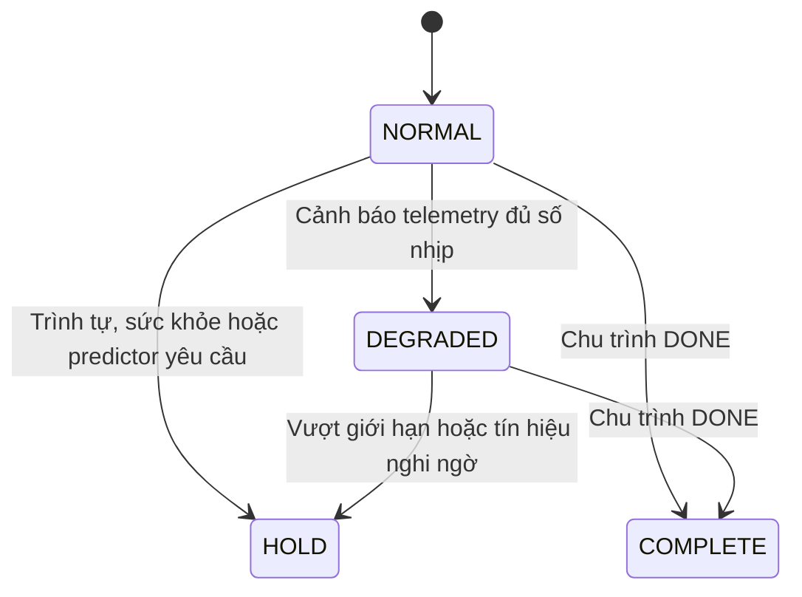

# Tái cấu hình phần mềm: giảm tốc có điều kiện và HOLD

Hạng mục ngày 30/10/2026, Docker `candidate-20261030-reconfiguration`.
Trạng thái: candidate chờ người dùng kiểm nghiệm, chưa nghiệm thu vật lý.

## Những gì vừa làm và tác dụng

| Phần bổ sung | Chức năng | Tác dụng trong dự án |
|---|---|---|
| `mujoco/reconfiguration.py` | Chọn NORMAL, DEGRADED, HOLD hoặc COMPLETE từ dữ liệu bên nhận. | Biến dấu hiệu bất thường thành thay đổi hành vi có quy tắc. |
| Tích hợp trong `experiment.py` | Áp chính sách sau trình tự/cảnh báo, trước predictor và trước phát lệnh. | Lệnh tốc độ từ lịch thử vẫn phải qua giới hạn chính sách; predictor được quyền HOLD tiếp. |
| Nhóm `reconfiguration` trong `config.py` | Kiểm tra ngưỡng, số nhịp cảnh báo, tốc độ giảm và mô-đun phụ thuộc. | Có thể nhập thông số mới mà không sửa thuật toán; cấu hình mâu thuẫn bị từ chối. |
| `configs/reconfigurable_cell_20261030.json` | Profile riêng bật chính sách trên plant tham số hiện có. | Thử chức năng mới mà vẫn giữ được profile observer và baseline cũ. |
| `configs/reconfiguration_parameters_to_fill_20261030.csv` | Bảng 202 trường số, ô đo để trống. | Ghi số đo và thiết lập thiết kế có đơn vị; không nhầm giá trị chưa đo với 0. |
| `test_reconfiguration.py` | Kiểm tra ưu tiên HOLD, giới hạn tốc độ, latch và điều kiện cấu hình. | Chặn các lỗi như lịch tốc độ ghi đè cap hoặc dữ liệu tốt tự xóa HOLD. |
| `check_reconfiguration.py` | 15 kịch bản mô phỏng, gồm đối chứng bật/tắt chính sách và chạy chậm cố định. | Kiểm tra tác dụng thực tế của thay đổi trong phạm vi mô phỏng một phôi. |
| Launcher/PowerShell/CI/Docker | Thêm chế độ `reconfiguration-check` và candidate riêng. | Thành viên có thể chạy cùng phiên bản, giữ log và đối chiếu kết quả. CI chưa chạy từ xa. |

Đây là **tái cấu hình tốc độ và chế độ vận hành bằng phần mềm**. Không thay băng
tải, đầu hút hoặc cơ cấu máy. Chưa có tự thay thế cảm biến hỏng, bộ tối ưu tốc độ,
ML/RL hoặc tự khởi động lại từ HOLD trong hạng mục này.

## Quy tắc hoạt động



**NORMAL:** giữ lệnh do trình tự/lịch thử yêu cầu. Một cảnh báo đơn lẻ chưa đủ
ngưỡng không tự làm giảm tốc.

**DEGRADED:** khi tuổi quan sát đạt ngưỡng cảnh báo, hoặc có khoảng khuyết quan
sát trong đủ số nhịp liên tiếp, chính sách chốt chế độ chạy giảm tốc cho chu
trình hiện tại. Trong TRACK:

`tốc_độ_được_chọn = min(tốc_độ_yêu_cầu, giới_hạn_DEGRADED)`.

Lệnh dừng bằng 0 và lệnh chậm hơn cap được giữ nguyên. Chính sách không đổi tốc
độ băng cấp ngang, đích XY, xi lanh hoặc lệnh hút để tránh làm sai quy trình căn
tâm và gắp. Mạng tốt trở lại cũng không tự tăng tốc trong chu trình đang có phôi.
Một lần chạy mới tạo bộ điều khiển/chính sách mới, không phải resume phôi cũ.

**HOLD:** giữ cơ chế dừng đã có của controller. Các dấu hiệu như thiếu cạnh dự
kiến, tín hiệu quang kéo dài khi vẫn ra lệnh chạy, dữ liệu cũ/thiếu, thứ tự sai
hoặc hai công tắc mâu thuẫn có thể yêu cầu HOLD. Nếu controller đã HOLD, giữ nguyên
lý do đầu tiên; không tự xóa HOLD sau một gói tốt. Lệnh chân không hiện có được giữ.

Các dấu hiệu trên vẫn là **nghi ngờ**, không chứng minh nguyên nhân là cảm biến.
HOLD là phản ứng bảo thủ trước việc chưa đủ thông tin, không phải chứng nhận an
toàn máy. Nếu mô-đun sức khỏe không cung cấp kết quả khi chính sách đang bật,
chính sách cũng HOLD thay vì tiếp tục chạy mù.

**COMPLETE:** chu trình đã DONE. Để tránh hiểu nhầm, đây là trạng thái kết thúc,
không phải một chế độ tăng năng suất.

## Thứ tự ưu tiên và nguồn dữ liệu

1. `sequence.py` kiểm tra mẫu, cập nhật ước lượng và trình tự; có quyền HOLD.
2. Lịch tốc độ tạo yêu cầu thử nghiệm nếu vẫn đang TRACK.
3. `health.py` đọc gói nhận được, lệnh tại nguồn và ước lượng để tạo dấu hiệu.
4. `reconfiguration.py` chốt DEGRADED, giới hạn tốc độ hoặc yêu cầu HOLD.
5. `supervisor.py` dự báo 1D với biên tốc độ bảo thủ; vẫn có quyền HOLD.
6. Lệnh cuối cùng mới được ghi vào lịch sử và phát cho MuJoCo.

Chính sách không nhận nhãn lỗi chủ động gây ra, vị trí/vận tốc thật của phôi
hoặc thống kê bên trong mạng giả lập. Các dữ liệu đó chỉ dùng ở bộ đánh giá.
Giảm lệnh tốc độ không được coi là phôi đã giảm tốc ngay: predictor vẫn xét
lệnh tốc độ cao trong khoảng dữ liệu cũ đang thiếu.

## Các tham số bạn có thể chỉnh

Profile mới giữ toàn bộ 199 trường số của observer và thêm 3 trường số chính sách:

| Trường | Mặc định | Giải thích |
|---|---|---|
| `reconfiguration.enabled` | true | Bật/tắt chính sách; false vẫn giữ trình tự, observer và predictor. |
| `warning_age_s` | 0.02 s | Tuổi dữ liệu bắt đầu cảnh báo; nhỏ hơn ngưỡng stale/silence cứng. |
| `warning_ticks` | 2 | Số nhịp quyết định cảnh báo liên tiếp trước khi chốt DEGRADED. |
| `degraded_long_speed_m_s` | 0.12 m/s | Cap của băng dài trong TRACK. Phải nằm trong dải thử và không vượt tốc độ danh định. |

Ngưỡng cảnh báo phải từ một chu kỳ lấy mẫu trở lên. Đổi chu kỳ lấy mẫu hoặc
tốc độ danh định có thể đòi hỏi sửa các ngưỡng liên quan; validator kiểm tra
các ràng buộc này. Đây là tham số thiết kế chưa hiệu chuẩn, không phải số đo máy.

Profile chỉ được thay trước lượt chạy. Chưa hỗ trợ sửa nóng tham số giữa chu trình.
CSV có 202 trường số bao gồm cả thiết lập thiết kế; không phải 202 đại lượng phải đo.

## Chạy thử từng bước

Mở PowerShell, chạy:

```powershell
Set-Location 'C:\Users\Admin\Documents\ChatGPT\plc'
.\scripts\docker_dt.ps1 -Mode demo
.\scripts\docker_dt.ps1 -Mode reconfiguration-check
.\scripts\docker_dt.ps1 -Mode fault
```

Lệnh thứ hai chạy 15 kịch bản và in PASS/FAIL từng ca. Kết quả nằm trong thư mục
mới dưới `output/docker/reconfiguration-check_...`; launcher in đường dẫn đầy đủ.

Mở các tệp theo thứ tự:

1. `results.json`: từng ca DONE/HOLD, lý do, kết quả hỗ trợ/đặt phôi do evaluator chấm.
2. `comparison.json`: đối chứng bật/tắt và so với chạy chậm cố định.
3. Trong từng ca, `reconfiguration.jsonl`: từng nhịp, tuổi dữ liệu, mã dấu hiệu,
   lệnh yêu cầu và lệnh sau chính sách. Đây là vị trí dễ xem chính sách đang làm gì.
4. `issued_commands.json`: lệnh cuối thực sự phát cho băng dài, sau cả supervisor.
5. `summary.json`: `reconfiguration.events` là các lần đổi chế độ, không phải toàn
   bộ các nhịp; `health.jsonl` vẫn giữ nhật ký dấu hiệu riêng.

`selected_long_speed_m_s` trong log chính sách là lệnh sau chính sách; predictor
hoặc giới hạn run-budget sau đó vẫn có thể đổi nó thành dừng. Muốn biết lệnh
cuối cùng, đọc `controller.jsonl` hoặc `issued_commands.json`.

Muốn đổi thử nghiệm, sao chép profile thành `my_reconfiguration.json`, chỉnh
ngưỡng hoặc `network.delay_s`, rồi chạy:

```powershell
.\scripts\docker_dt.ps1 -Mode demo -Config my_reconfiguration.json
```

Không sửa profile của image cũ để làm bằng chứng nghiệm thu. Mỗi lượt lưu cấu
hình hiệu lực và hash để truy ngược thông số đã dùng.

## Kết quả phát triển và cách diễn giải

Lượt `output/reconfiguration_dev_20261030_b` qua 15/15 ca. Lượt a được giữ lại:
ca baseline trễ 20 ms đã HOLD đúng theo bất định, nhưng bảng kỳ vọng ban đầu
ghi DONE nên bộ kiểm tra báo FAIL. Sau khi đọc log, kỳ vọng được sửa thành HOLD
đúng lý do, đồng thời thêm đối chứng chạy chậm cố định để làm rõ kết quả.

Với cùng plant, nguồn tín hiệu và độ trễ 20 ms:

- Tắt chính sách, giữ 0,16 m/s: HOLD vì bất định tại điểm gắp vượt ngưỡng.
- Bật chính sách: tự giới hạn 0,12 m/s và hoàn tất đặt phôi.
- Tắt chính sách, đặt cố định 0,12 m/s: cũng hoàn tất, cùng thời gian chu trình
  với trường hợp tự giảm tốc trong fixture này. Không chứng minh thuật toán mới
  nhanh hơn chạy chậm cố định hoặc tối ưu tốc độ.
- Thiếu cạnh pickup: chính sách HOLD sớm hơn timeout đối chứng khoảng **0,62 s**.
  Đây là phản ứng từ quy tắc thiếu cạnh đã có, không phải dự đoán trước lỗi 0,62 s.
- Trễ 40 ms vẫn HOLD vì bất định; chính sách không nới ngưỡng để ép gắp.

Các ca đúng chức năng dùng budget predictor 1 s, tách khỏi nhiễu lập lịch host.
Ca `runtime_20ms` giữ budget vận hành 20 ms và chấp nhận DONE hoặc HOLD có phôi
được hỗ trợ. Không suy ra bảo đảm deadline từ một lần chạy. Bản observer trước
đã ghi nhận deadline miss trên máy này; giới hạn đó vẫn còn.

Chưa thể dùng các fixture này để tuyên bố tỷ lệ phát hiện lỗi, độ tin cậy máy thật,
khả năng tự vận hành liên tục nhiều phôi hoặc độ chính xác công nghiệp. CAD V5 và
plant chức năng MuJoCo vẫn chưa đồng bộ toàn bộ hình học/động lực học.

## Kiểm tra trong Docker candidate

Image: `sha256:1eaf75229e7080cb3ea585c846a9960bc246e37c7e4dc7b5b20228e552463200`.
Kết quả của lượt đóng gói này:

| Kiểm tra | Kết quả |
|---|---|
| Logic trong image | 63/63 |
| Biên đóng gói trên host | 2/2 |
| Tái cấu hình | 15/15 |
| Observer | 13/13 |
| Plant tham số, kiểm tra chức năng budget 1 s | 18/18 |
| Dự báo legacy | 10/10 |
| Demo mặc định | DONE, đặt phôi đạt, 13,92 s mô phỏng |
| Strict | HOLD vì thiếu xác nhận XY/A2 trung gian/chân không |

Tất cả hash runtime khớp mã nguồn. Image accepted và các candidate cũ vẫn nguyên
vẹn; chưa có xác nhận cá nhân của người dùng cho hạng mục này. Bằng chứng đầy đủ
ở `docker/evidence/candidate-20261030-reconfiguration.json` và log tại
`output/docker/qualification_20261030_reconfiguration/`.

## Việc tiếp theo sau hạng mục này

Sau khi kiểm nghiệm hạng mục này, cần mở rộng ma trận thử theo nhiều seed, độ
trễ/jitter và biên tham số, đo tỷ lệ hoàn tất, HOLD nhầm và độ trễ phản ứng. Kế
tiếp mới thiết kế reset có xác nhận/đồng bộ lại trạng thái; tuyệt đối không coi
gói mạng tốt trở lại là đủ điều kiện chạy tiếp một phôi đang dang dở.
