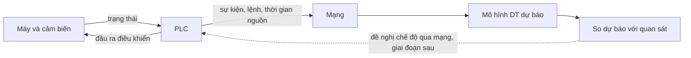

# Đề tài liên hệ với Digital Twin, PLC, sản xuất tự động và mạng thế nào?

## Câu trả lời ngắn

Đề tài nghiên cứu **một dịch vụ giám sát dự báo của Digital Twin cho hệ sản xuất
kết nối mạng**. Máy tạo ra hành vi và tín hiệu; PLC điều khiển máy và ghi nhận
sự kiện; mạng vận chuyển dữ liệu; DT dự báo diễn biến rồi so với quan sát, đồng
thời đánh giá dữ liệu có đủ để kết luận không.

Hiện phần được đánh giá là mô hình và dịch vụ giám sát trong môi trường ảo.
MuJoCo đóng vai máy thử nghiệm. Chưa có liên kết trực tuyến với PLC vật lý,
chưa chứng minh máy vẫn sản xuất được khi mất phản hồi bắt buộc.

## Bốn phần trong cùng một bài toán

| Thành phần | Vai trò trong phương pháp | Trạng thái dự án |
|---|---|---|
| Digital Twin | Mô hình trạng thái/hành vi để dự báo sự kiện bình thường, so dự báo–quan sát và chỉ rõ giới hạn sử dụng | Có mô hình rút gọn, Ridge, miền sự kiện và bộ giám sát; chưa đồng bộ máy thật |
| PLC | Điều khiển đầu ra, giữ trình tự/liên động, cung cấp tín hiệu và lệnh đã thực thi | Có nền điều khiển/mô phỏng trong kho; mô đun giám sát mới chưa đọc/ghi S7 trực tuyến |
| Sản xuất tự động | Đối tượng và mục tiêu vận hành: đưa phôi, đẩy, di chuyển, hút, gắp/thả đúng trình tự | Bệ thử có các cơ cấu; phép so hiện tại tập trung sự kiện quang, chưa chấm năng suất toàn chu trình |
| Mạng máy tính | Quyết định dữ liệu tới khi nào, thiếu gì, còn mới hay đã cũ, có đủ thứ tự/lịch sử không | Đã thử trễ, mất đoạn gói và tuổi dữ liệu trong lịch phát lại; chưa đo mạng PLC thật |

Đây là công việc ở giao điểm mô hình dự báo, điều khiển giám sát và hệ phân tán.
Bài viết phát biểu lớp phương pháp tổng quát; dây chuyền hiện tại là một nghiên
cứu tình huống. Mỗi loại thiết bị khác cần bộ nối, mô hình và hiệu chuẩn riêng.

## Digital Twin nằm ở đâu?

Khi có dữ liệu quan sát và lệnh điều khiển đến thời điểm hiện tại, mô hình dự
báo mốc tiếp theo: phôi tới cảm biến, xi lanh tới đầu hành trình, hoặc trục tới
vị trí. Sau đó giám sát ba trạng thái: còn nhất quán với miền dự báo, tiến độ
không khớp, hoặc chưa đủ bằng chứng để đánh giá. Một giá trị False chưa tự cho
biết cảm biến hỏng, phôi chưa tới hay truyền động đang đứng.

Bộ dự báo hiện tại dùng độ dài xung quang để ước lượng chuyển động. Ridge là
một phương án học phần sai lệch từ dữ liệu; nó không tự có quyền điều khiển.
Một DT có thể dùng mô hình vật lý, mô hình học hoặc phối hợp; lợi ích phải được
so bằng mục tiêu cụ thể, không suy từ tên công nghệ.

NIST mô tả DT sản xuất là mô hình ảo được đồng bộ để biểu diễn, chẩn đoán, dự
báo và tối ưu. Do còn thiếu đồng bộ với máy thật, cách gọi chính xác cho kết
quả hiện nay là **khung/lõi DT dự báo đang được kiểm chứng ảo**.
Nguồn: https://www.nist.gov/programs-projects/digital-twins-advanced-manufacturing

## PLC làm gì khi ghép vào sau này?

PLC tiếp tục thực thi chương trình điều khiển, đọc đầu vào và cập nhật đầu ra.
Siemens mô tả process image (ảnh trạng thái vào/ra) để chương trình dùng tập
trạng thái nhất quán trong một chu kỳ. Dấu thời gian và sự kiện xuất cho DT
phải được gắn với quá trình lấy mẫu tại nguồn;20 ms của mô phỏng không phải
chu kỳ quét đã đo của CPU1214C.
Nguồn: https://docs.tia.siemens.cloud/r/en-us/v20/functional-description-of-s7-1200-cpus-s7-1200/memory-areas-s7-1200/system-memory-s7-1200/process-image-input/output-s7-1200/basic-principles-of-process-images-s7-1200

Hợp đồng dữ liệu dự kiến gồm phiên/chu kỳ, số thứ tự, thời gian nguồn, pha đang
chạy, giá trị/chất lượng tín hiệu và lệnh tốc độ đã thực thi. Khi có kết quả đủ
kiểm chứng, DT có thể đề nghị một chế độ đã chuẩn bị như hạn tốc độ. PLC kiểm
tra điều kiện, giới hạn, thời hạn yêu cầu và xác nhận trước khi thực hiện.
Đây là thay đổi tham số/chế độ trong thiết kế được kiểm tra; chưa phải chức
năng đã triển khai của mô đun mới. Chưa chọn giao thức hoặc xác nhận tính năng
truyền thông cụ thể của CPU/firmware đang dùng.

## Mạng làm thay đổi ý nghĩa của quan sát

Giả sử gói báo cảm biến False được PLC ghi lúc10,000 s, tới DT lúc10,080 s,
trong khi hạn dự kiến là10,050 s. Gói đó mô tả hệ thống đến10,000 s; nó chưa
cung cấp bằng chứng rằng sự kiện vẫn vắng mặt sau10,050 s. Lấy thời gian nhận
để kết luận đã quá hạn có thể gây báo nhầm. Khi các mẫu nguồn mới hơn vượt hạn
và đủ số mẫu liên tiếp theo cấu hình, bộ giám sát mới có căn cứ báo tiến độ sai.

Tuổi dữ liệu cần đồng hồ tương thích hoặc ánh xạ thời gian đã kiểm chứng giữa
PLC và máy tính. Hiện thí nghiệm dùng chung đồng hồ mô phỏng. Còn cần xử lý
hàng đợi, mất gói, thứ tự, chất lượng và đo độ trễ thật trước khi phát biểu về
triển khai mạng công nghiệp. Học máy không tự phục hồi thông tin chưa được đo.

## Mối liên hệ dẫn tới công việc nghiên cứu tiếp theo

Trong bộ mới, dùng thời gian nguồn giảm báo nhầm do trễ so với đối chứng bỏ qua
dấu thời gian. Tuy vậy vẫn có2 ca báo nhầm trong6 ca đủ đầu vào ngay cả không
trễ. Rà dữ liệu chấm cho thấy vận tốc trung bình sau xung cao hơn trong xung ở
cả6 ca; giả thiết vận tốc không đổi cần được xét lại. Phần này nối trực tiếp:

- DT: mô hình chuyển động và miền không chắc chắn phải đúng điều kiện.
- PLC: lịch sử lệnh/khởi động là thông tin có thể giúp dự báo đúng giai đoạn.
- Tự động hóa: cảnh báo phải phản ánh tiến độ cơ cấu, rồi mới hỗ trợ vận hành.
- Mạng: các lịch sử và sự kiện phải giữ được ý nghĩa thời gian khi truyền.

Sơ đồ kiến trúc dự kiến (đường nét đứt là phần chưa triển khai):

Hướng nghiên cứu trước mắt là làm mô hình và cách dùng dữ liệu đáng tin cậy
hơn. Tự cấu hình PLC và chứng minh lợi ích vận hành sẽ cần bước kiểm chứng
riêng; không chuyển thẳng cảnh báo hiện tại thành quyền cho máy chạy tiếp.
